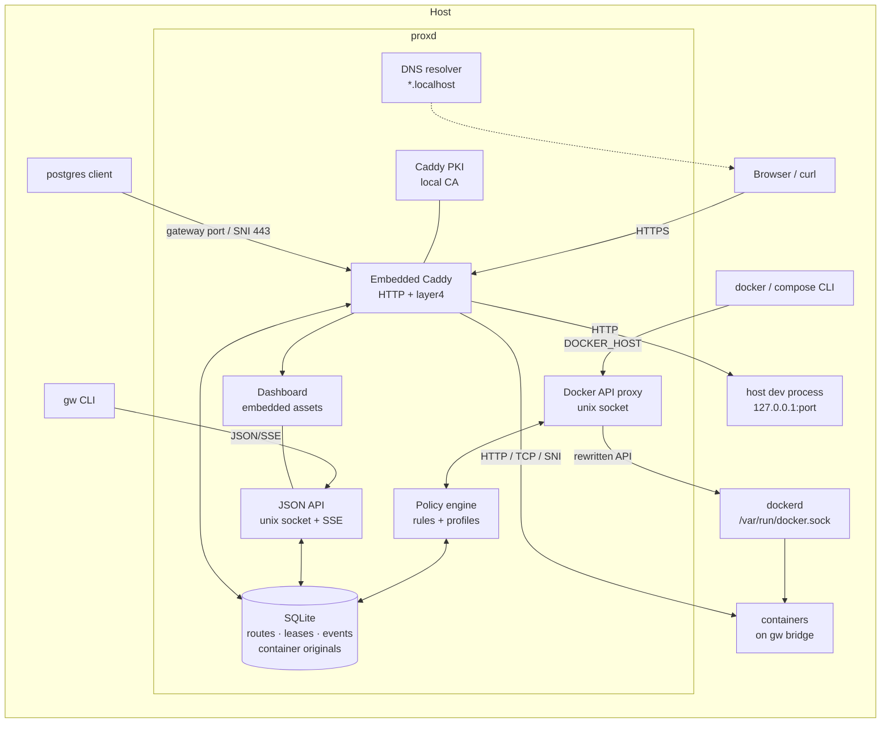
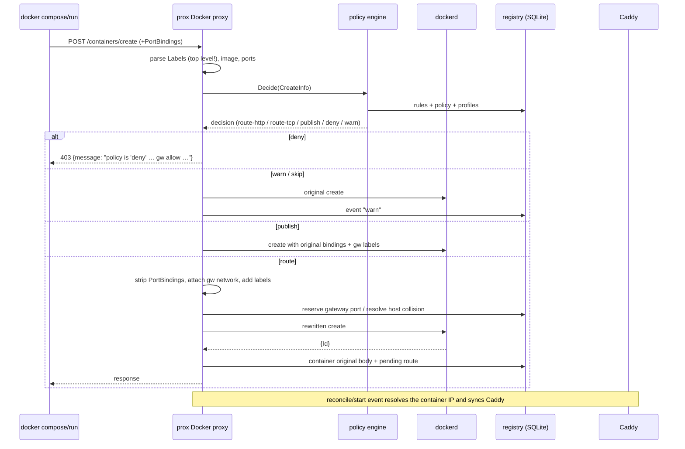
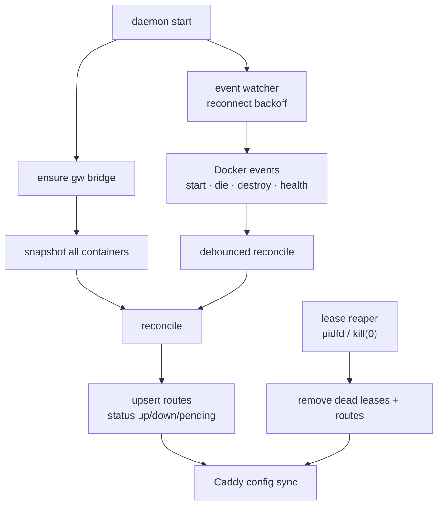
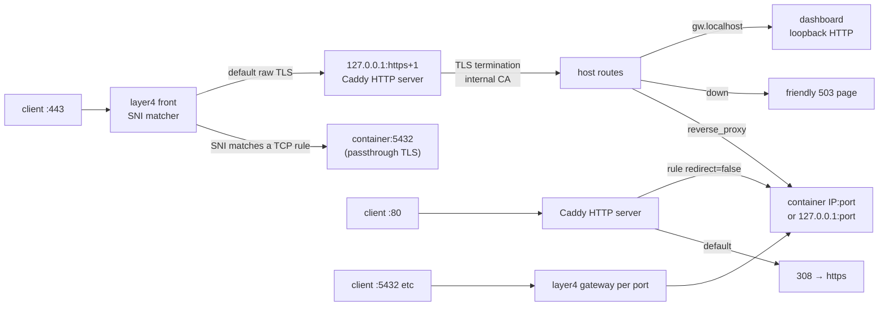
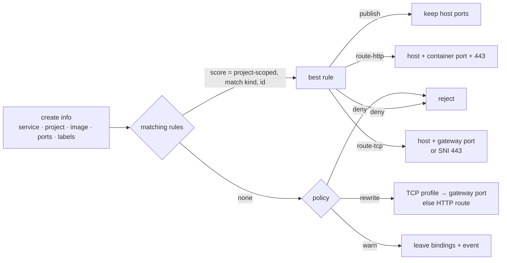
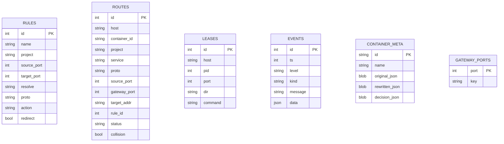

# prox architecture

## Components



Everything except Caddy's public listeners and the Docker proxy socket lives
behind local sockets. SQLite is the source of truth; Caddy configuration is
derived from the route table on every change and re-applied atomically through
`caddy.Load`.

## Container create path



The original create JSON is stored per container. `GET /containers/{id}/json`
and `GET /containers/json` inject the original `HostConfig.PortBindings`,
`PublishAllPorts`, `ExposedPorts` and `NetworkMode`, plus a derived
`NetworkSettings.Ports`. This is what makes Compose's second `up` report
`Running` instead of recreating.

## Start / stop / reconcile



Reconcile is idempotent. It:

1. creates the `gw` network if missing;
2. verifies managed containers, attaches `gw` when needed, resolves
   backend-specific addresses, probes `/proc/<pid>/net/tcp*` for a port when
   detection was deferred, and marks unhealthy/stopped routes down;
3. removes routes and stored create bodies for containers that no longer exist
   (destroy events do this immediately; a grace period covers racing creates);
4. keeps gateway-port reservations aligned with live TCP routes;
5. reaps leases whose PID is gone;
6. recomputes unmanaged warnings and pushes a single Caddy config.

Destroy events remove routes immediately. Compose recreates reuse the same
container name; if the old route is still present, the proxy reassigns it
instead of renaming the hostname.

## Caddy layout

Layer4 always owns the public HTTPS port so a reload can move between "no SNI
routes" and "SNI routes" without a bind race.



Certificates come from Caddy's internal PKI. Every route hostname (plus
`gw.localhost`) is in an explicit automation policy using the `internal` issuer,
so certificates are issued per hostname without public ACME. The root CA is
created on first boot at:

```
<state>/ca/pki/authorities/local/root.crt
```

## Policy resolution



Match kinds, most specific first: service name, container name, image name,
profile name. Project-scoped rules beat global; within the same specificity,
later rules beat earlier ones.

Hostname collisions are resolved at route creation: the first route keeps the
short name, subsequent projects get `<name>.<project>.localhost` (or `-2`
suffixes if that is also taken), a warning event is emitted, and the renamed
route is marked `collision` in SQLite.

## Data model



`container_meta` powers inspect rewriting. `gateway_ports` makes reservations
survive daemon restarts and prevents reassignment while a lease is active.

## API

The Unix-socket JSON API is the single source of truth for the CLI and
dashboard:

| Endpoint | Purpose |
| --- | --- |
| `GET /v1/status` | policy, backend, sockets, counts, health |
| `GET/POST /v1/rules`, `DELETE /v1/rules/{id}` | rule CRUD |
| `GET /v1/routes`, `DELETE /v1/routes/{id}` | routes |
| `GET/POST /v1/leases`, `DELETE /v1/leases/{id}` | host-process leases |
| `GET /v1/events`, `GET /v1/events/stream` | history and SSE |
| `GET/POST /v1/policy` | rewrite/deny/warn |
| `POST /v1/check` | dry-run a Compose file |
| `GET /v1/containers`, `GET /v1/suggest` | dashboard allow buttons |
| `POST /v1/reconcile` | force a sweep |
| `GET /v1/ca` | root CA PEM |
| `GET/POST /v1/enforce` | AuthZ plugin control |
| `GET /v1/doctor?fix=1` | health checks and safe fixes |
| `/` | embedded dashboard |

The same handler runs on the Unix socket and on an ephemeral loopback listener
that Caddy exposes as `gw.localhost`.

## Backends

`internal/backend.Backend` isolates native Linux Docker from rootless and Docker
Desktop:

- `Name()`, `RequiresPublishedPorts()`, `ResolveAddress(container, port)`,
  `CanBind(port)`.
- **native** dials the container's `gw` bridge IP.
- **rootless/desktop** cannot assume host-routable container IPs. The proxy adds
  a loopback-only ephemeral publication for each routed port at create time;
  the backend resolves `127.0.0.1:<assigned>` and inspect rewriting still hides
  it from Compose.

## Security boundaries

- The Docker proxy socket is 0660; the API socket is 0600. In the default
  system install the daemon runs as root.
- Enforcement uses a legacy Docker AuthZ plugin. Every prox-forwarded create is
  signed with HMAC-SHA256 over the rewritten body (key stored 0600 in the state
  dir). The plugin allows unsigned creates only when a `publish` rule matches,
  and denies port-binding creates from the raw socket otherwise.
- The CA private key stays under the state dir. `gw ca install` only copies the
  public root certificate.
- No container is granted elevated privileges by prox; the daemon only rewrites
  API payloads and attaches a bridge network.
